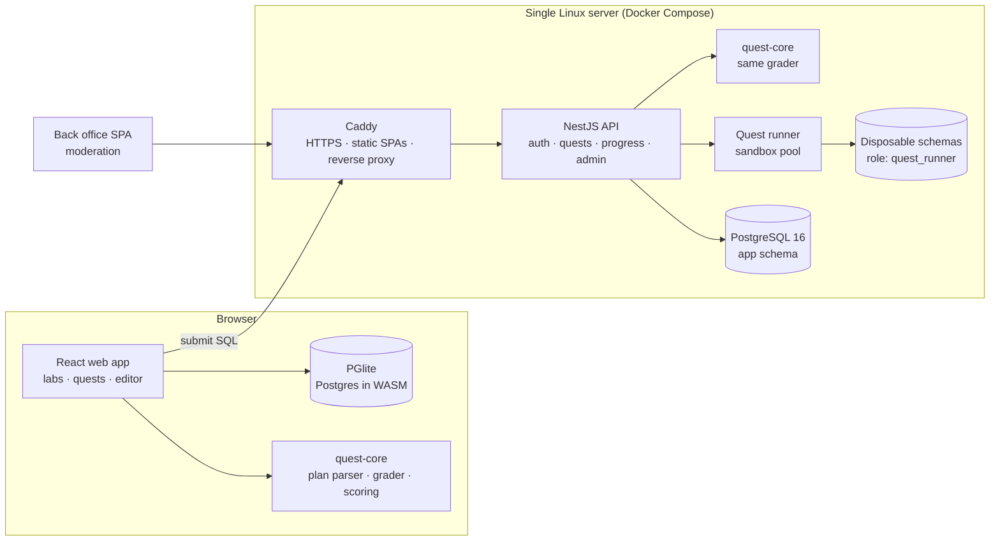

# dbplay

**Learn how Postgres actually behaves by breaking it, fixing it, and getting graded on the query plan.**

dbplay is an interactive Postgres playground and puzzle game. You run SQL in the browser, watch a plan flip from `Seq Scan` to `Index Scan` the moment you add the right index, step through isolation anomalies, and solve quests that are graded on the **plan** rather than the stopwatch.

<!-- TODO: live link once launched: https://dbplay.org -->

> **About this repository:** this is the public showcase for dbplay. It covers the product, the architecture and the key engineering decisions. The source code is private (proprietary). I'm happy to walk through it in an interview or grant read access on request: [LinkedIn](https://www.linkedin.com/in/TODO).

---

## What it does

### Labs (run entirely in the browser on PGlite, Postgres compiled to WebAssembly)

| Lab | What you learn |
|---|---|
| **Playground** | SQL editor with `Run`, `EXPLAIN` and `EXPLAIN ANALYZE`, rendered as a readable plan tree |
| **Index Lab** | The same query with and without an index, both plans side by side |
| **Isolation Lab** | Deterministic walkthrough of non-repeatable reads, phantom reads and lost updates under Read Committed, Repeatable Read and Serializable |
| **Text Search** | Races full-text index strategies on reads, then measures what each costs on writes |
| **Share links** | Scenario, query and tab compressed into the URL fragment, no backend needed |

### Quests: constraint puzzles graded on the query plan

- **237 built-in quests** across 8 realistic datasets (marketplace, ledger, rides, telemetry, support, social, library and more).
- **8 difficulties, 8 player levels**, paced like Codewars' 8 kyu → 1 kyu. Tasks range from "index a `WHERE email = …`" to "tune a 9-query production workload under a write budget and a cost ceiling near the best known solution".
- Win conditions read the real plan: *no Seq Scan*, *Index Only Scan*, *no Sort*, *max heap fetches*, *max rows examined*, *index budget*, *write amplification budget*, *total cost ceiling*, *same rows as the reference query*.

<b>More demos:</b> quest catalogue and a 5-query workload-tuning quest

- **Community quests:** players who reach the author level can write quests. A quest can only be published with a solution the server has verified, and moderators approve it in a separate back office.

---

## Architecture at a glance

The browser gives **instant feedback** on PGlite, but the server **never trusts that verdict**. On submit, the API re-runs the SQL on real Postgres in an isolated sandbox and awards honor only from its own result. Both sides share one framework-free grading package, so "+N honor" in the UI matches what the server awards.

More detail: [docs/architecture.md](docs/architecture.md)

---

## Engineering highlights

- **Running untrusted SQL safely, with defence in depth** ([ADR-0003](docs/adr/0003-untrusted-sql-defence-in-depth.md)):
  - a least-privilege Postgres role that the API checks at boot, refusing to start if the role is over-privileged
  - a fresh disposable schema for every grade, always rolled back
  - an AST-level SQL allowlist using the real Postgres parser (`libpg-query`)
  - statement and idle timeouts
  - a capped sandbox pool and per-user rate limits
- **Client for speed, server for trust** ([ADR-0002](docs/adr/0002-server-authoritative-grading.md)): the same grader runs in two runtimes, and the client is never the source of truth.
- **Grading on plans, not timings** ([ADR-0001](docs/adr/0001-grade-on-query-plans.md)): plans are deterministic and teachable, while timings on shared hardware are noise.
- **Every quest is provably solvable** ([ADR-0005](docs/adr/0005-deterministic-datasets-and-verified-quests.md)):
  - datasets are built deterministically
  - a verifier proves on real Postgres, under production limits, that the untouched quest fails, the reference solution passes and every "near miss" wrong answer fails
  - the same checks run again through the browser engine
- **Boring, cheap operations** ([ADR-0006](docs/adr/0006-single-server-compose-and-postgres-only.md)):
  - one server running Docker Compose with Caddy for automatic HTTPS
  - Postgres-backed rate limiting, so there's no Redis to run
  - migrations and seed run before every API start
  - daily off-server backups
  - Sentry configured to scrub passwords and submitted SQL
- **Security basics done properly:**
  - refresh tokens and reset tokens stored only as SHA-256 hashes, refresh tokens rotated on every use
  - single-use password-reset links that never reveal whether an email has an account
  - auth rate limits that see real client IPs behind the proxy
  - production refuses to boot with weak secrets
  - account deletion in a single transaction
- **CI quality gates on every push:**
  - lint (oxlint), unit tests (vitest and node:test), typecheck
  - production builds of both frontends and both Docker images
  - a migration drift check that fails when an entity changes without a matching migration

## Stack

**Backend:** NestJS 10 · TypeScript · TypeORM · PostgreSQL 16 · libpg-query · Zod · Passport (JWT, Google OAuth) · Resend · Sentry
**Frontend:** React 19 · Vite · CodeMirror 6 · PGlite (WASM)
**Infra:** Docker Compose · Caddy · GitHub Actions
**Repo:** npm workspaces monorepo (`apps/web`, `apps/backoffice`, `apps/server`, `packages/quest-core`), ~19k lines of TypeScript

## Decision log

| ADR | Decision |
|---|---|
| [0001](docs/adr/0001-grade-on-query-plans.md) | Grade on query plans, not wall-clock time |
| [0002](docs/adr/0002-server-authoritative-grading.md) | Instant client grading, authoritative server grading, one shared grader |
| [0003](docs/adr/0003-untrusted-sql-defence-in-depth.md) | Defence in depth for executing untrusted SQL |
| [0004](docs/adr/0004-framework-free-shared-core.md) | A framework-free `quest-core` package shared by browser and server |
| [0005](docs/adr/0005-deterministic-datasets-and-verified-quests.md) | Deterministic datasets and machine-verified quests |
| [0006](docs/adr/0006-single-server-compose-and-postgres-only.md) | Single-server Docker Compose, Postgres as the only stateful dependency |

---

## Status

Feature-complete and preparing for public launch. <!-- TODO: update when live -->

## Author

**Oleksandr (Alexander) Hrachov**, Engineering Lead / Senior Backend Engineer (Node.js · NestJS · TypeScript · PostgreSQL)
[LinkedIn](https://www.linkedin.com/in/TODO) · [GitHub](https://github.com/SASanchezz)

© 2026 Oleksandr Hrachov. dbplay's source code is proprietary. The text and diagrams in this repository may be shared with attribution.
