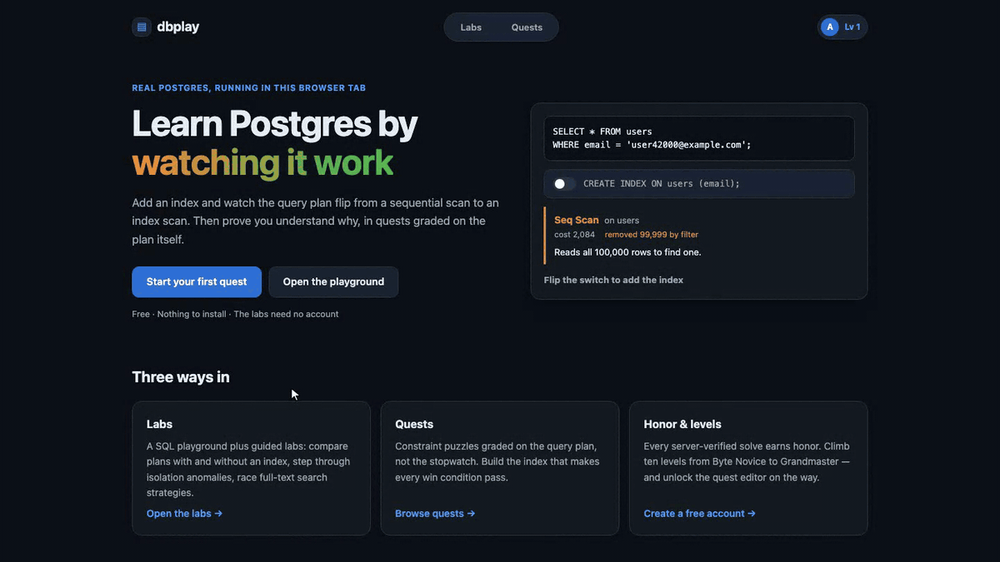
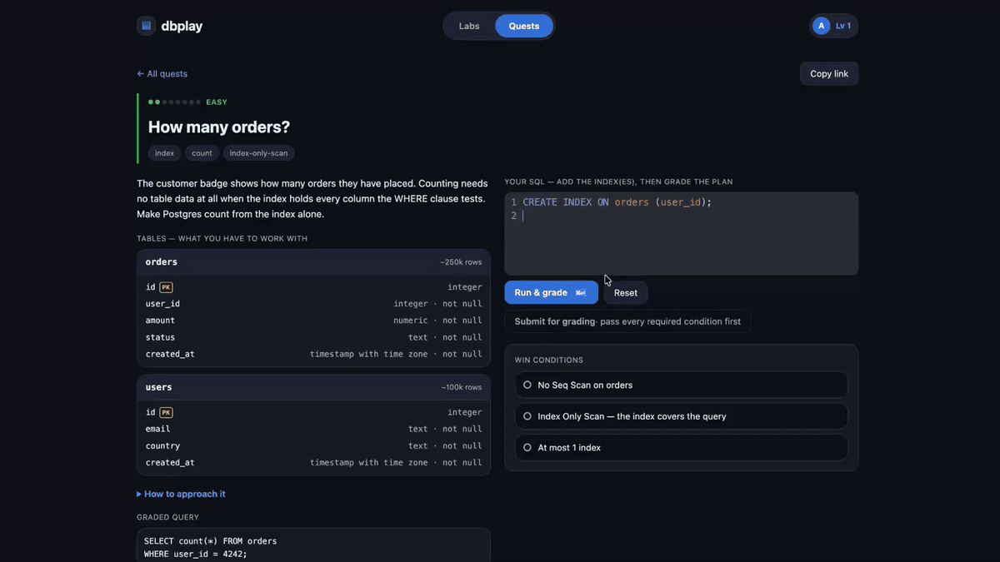
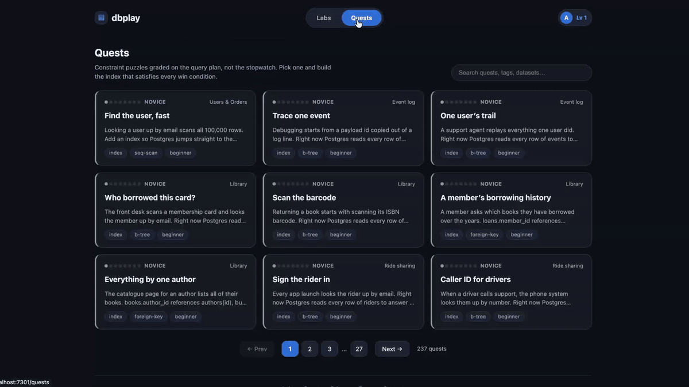
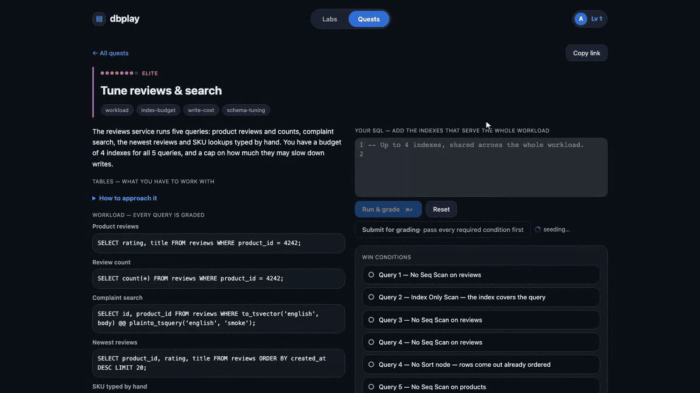
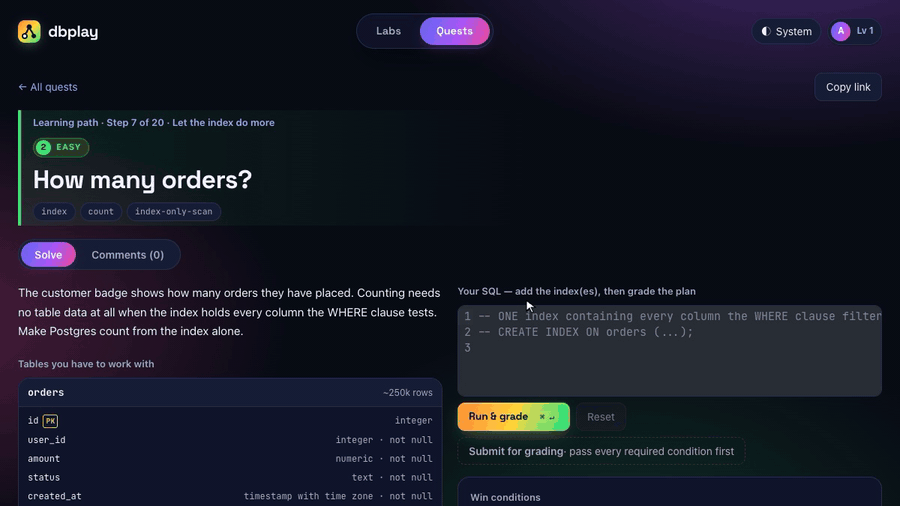
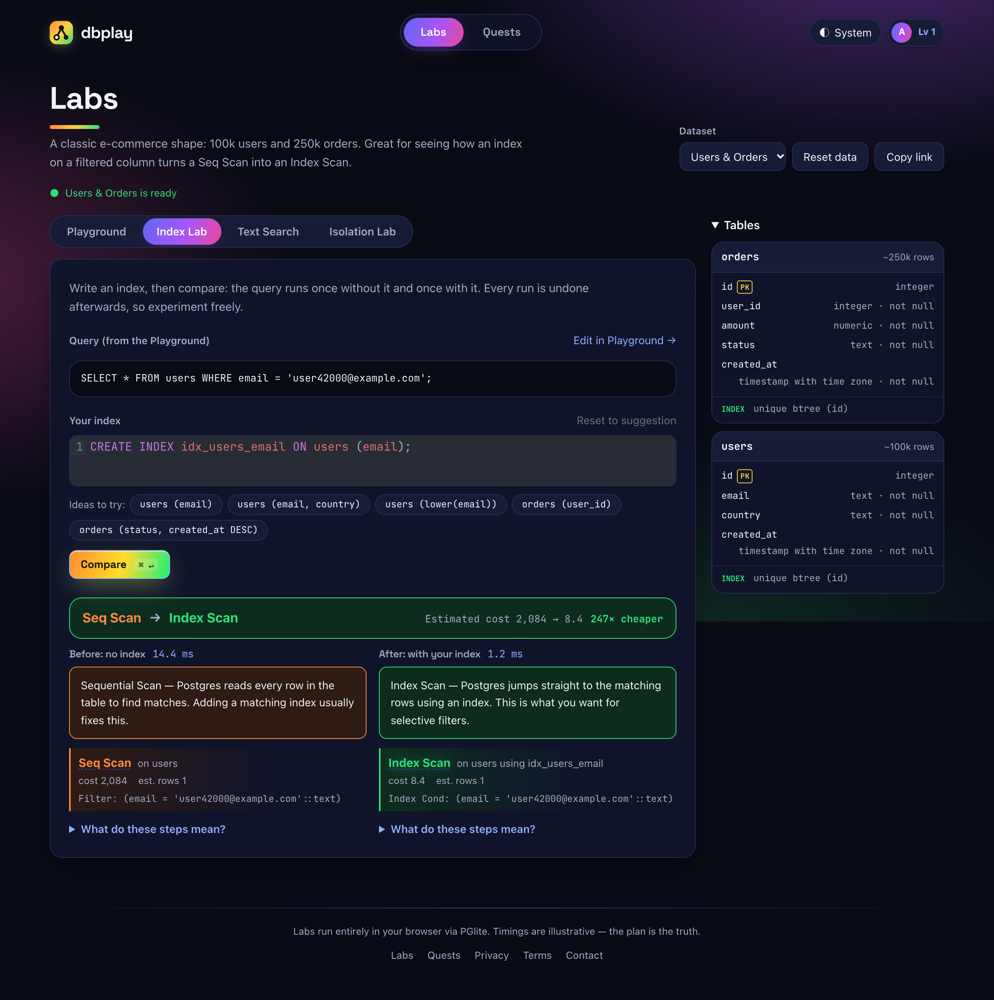
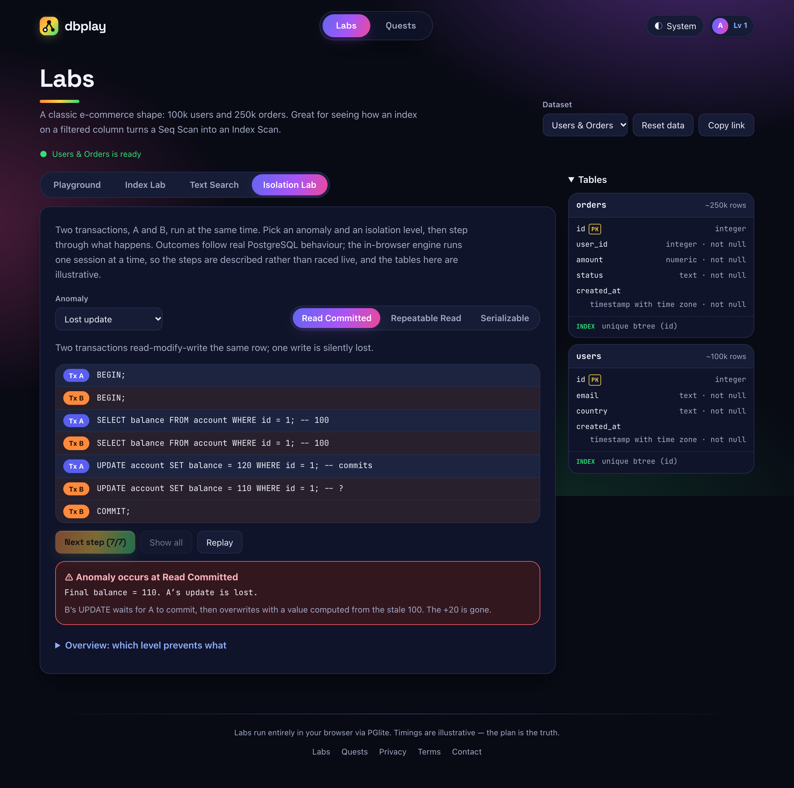
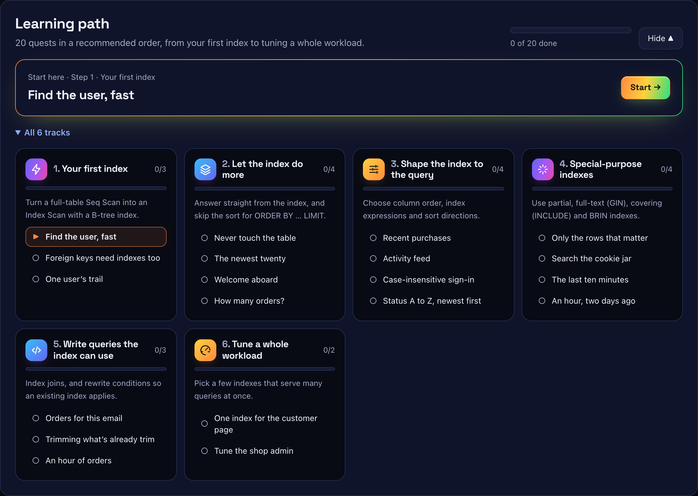
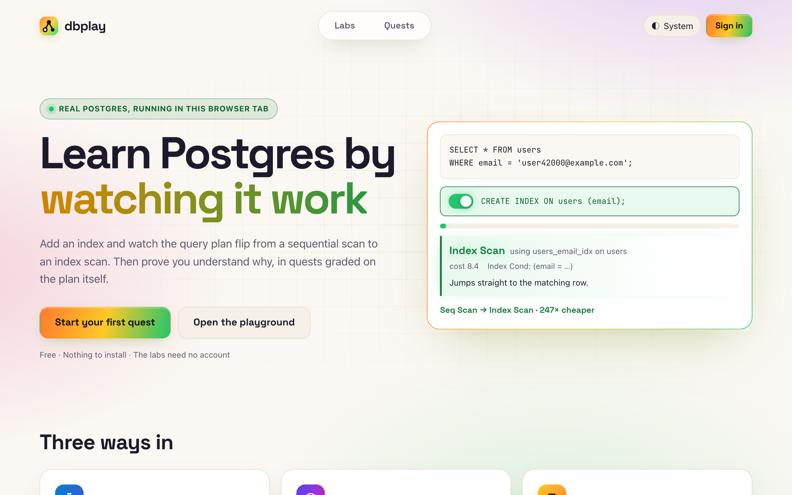
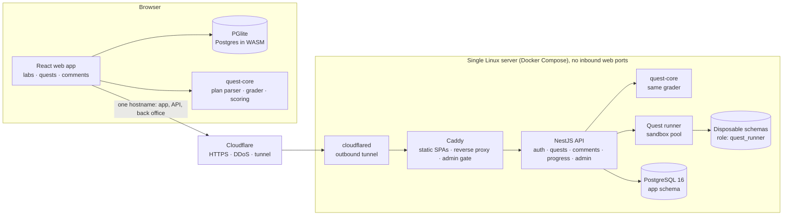

# dbplay

**Learn how Postgres actually behaves by breaking it, fixing it, and getting graded on the query plan.**

dbplay is an interactive Postgres playground and puzzle game. You run SQL in the browser, watch a plan flip from `Seq Scan` to `Index Scan` the moment you add the right index, step through isolation anomalies, and solve quests that are graded on the **plan** rather than the stopwatch.

It's my personal project, and I took it from idea to production on my own: product design, a React frontend running Postgres in WebAssembly, a NestJS API that safely executes untrusted SQL, a 237-quest catalogue that is machine-verified on every change, CI/CD, and a production server with error tracking, performance and log monitoring, uptime checks and automated backups.

**Live:** [quest.dbplay.site](https://quest.dbplay.site)

| | |
|---|---|
| **Scope** | Full stack, end to end: 2 React SPAs, a NestJS API, a shared TypeScript grading library, Docker Compose infrastructure |
| **Size** | ~26k lines of TypeScript in a 4-package monorepo, 237 built-in quests on 8 deterministic datasets |
| **Quality** | Every push runs lint, typecheck, unit tests in 3 packages, production builds, both Docker images and a migration drift check; deploys happen only after CI is green |
| **Operations** | Sentry error tracking, New Relic logs and server performance, UptimeRobot uptime checks, Docker health checks, daily and pre-migration backups, no open web ports |

> **About this repository:** this is the public showcase for dbplay. It covers the product, the architecture and the key engineering decisions. The source code is private (proprietary). I'm happy to walk through it in an interview or grant read access on request: [LinkedIn](https://www.linkedin.com/in/TODO).

---

## What it does

### Labs (run entirely in the browser on PGlite, Postgres compiled to WebAssembly)

| Lab | What you learn |
|---|---|
| **Playground** | SQL editor with `Run`, `EXPLAIN` and `EXPLAIN ANALYZE`, rendered as a readable plan tree |
| **Index Lab** | The same query with and without your index, both plans side by side with the cost difference |
| **Isolation Lab** | Step-by-step walkthrough of dirty reads, non-repeatable reads, phantom reads, lost updates and write skew under Read Committed, Repeatable Read and Serializable |
| **Text Search** | Races full-text index strategies on reads, then measures what each costs on writes |
| **Share links** | Scenario, query and tab compressed into the URL fragment, no backend needed |

### Quests: constraint puzzles graded on the query plan

- **237 built-in quests** across 8 realistic datasets (marketplace, ledger, rides, telemetry, support, social, library and more).
- **A learning path:** 20 quests in 6 tracks, from your first B-tree index to tuning a whole workload, all on the datasets the Labs use.
- **8 difficulties, 8 player levels**, paced like Codewars' 8 kyu → 1 kyu. Tasks range from "index a `WHERE email = …`" to "tune a 9-query production workload under a write budget and a cost ceiling near the best known solution".
- Win conditions read the real plan: *no Seq Scan*, *Index Only Scan*, *no Sort*, *max heap fetches*, *max rows examined*, *index budget*, *write amplification budget*, *total cost ceiling*, *same rows as the reference query*.
- **No account needed to play:** quests you pass in the browser and your unsaved SQL are kept locally. Signing in with a confirmed email lets you submit for server-verified honor and levels.

- **Comments without spoilers:** each quest has a discussion thread. The server refuses anything that reads as SQL or code, however it's disguised (casing, spacing, look-alike characters, spelled out letter by letter), so hints stay in words. Players can report comments, and moderators review them in the back office.
- **Community quests:** players who reach the author level can write quests. A quest can only be published with a solution the server has verified, and moderators approve it in a separate back office.

<b>More demos:</b> learning path and catalogue, an Elite workload quest, spoiler-free comments, the labs, light theme

---

## Architecture at a glance

The browser gives **instant feedback** on PGlite, but the server **never trusts that verdict**. On submit, the API re-runs the SQL on real Postgres in an isolated sandbox and awards honor only from its own result. Both sides share one framework-free grading package, so "+N honor" in the UI matches what the server awards.

More detail: [docs/architecture.md](docs/architecture.md)

---

## Engineering highlights

- **Running untrusted SQL safely, with defence in depth** ([how I decided](#how-i-work)):
  - a least-privilege Postgres role that the API checks at boot, refusing to start if the role is over-privileged
  - a fresh disposable schema for every grade, always rolled back
  - an AST-level SQL allowlist using the real Postgres parser (`libpg-query`)
  - per-grade limits: 5 s per statement, 30 s in total, 256 MB of tables and indexes, results size-capped inside Postgres
  - a capped sandbox pool, one running grade per user and per-user rate limits
- **Client for speed, server for trust** ([how I decided](#how-i-work)): the same grader runs in two runtimes, and the client is never the source of truth.
- **Grading on plans, not timings** ([how I decided](#how-i-work)): plans are deterministic and teachable, while timings on shared hardware are noise.
- **Every quest is provably solvable**:
  - datasets are built deterministically
  - a verifier proves on real Postgres, under production limits, that the untouched quest fails, the reference solution passes and every "near miss" wrong answer fails
  - the same checks run again through the browser engine
- **Spoiler-free discussion**: a server-side detector looks for SQL *syntax* rather than SQL *words*, so "select the rows where the email matches" passes while real code is refused. Tests cover disguised attempts, and per-user posting limits back it up.
- **Boring, cheap operations**:
  - one server running Docker Compose behind a Cloudflare Tunnel: no open web ports, and the server's address stays out of DNS
  - web app, API and back office on one hostname, so the refresh cookie stays first-party
  - automatic deploys after CI passes on `main`, over SSH with a pinned host key
  - a database dump before every migration (a failed dump stops the deploy), plus daily dumps
  - Postgres-backed rate limiting, so there's no Redis to run
  - open tabs survive a deploy: old assets are kept for 7 days, then the app reloads itself once
- **Security basics done properly:**
  - email confirmation before an account can submit or author, and sign-up never reveals whether an address is registered
  - refresh tokens and reset tokens stored only as SHA-256 hashes, refresh tokens rotated on every use
  - the back office answers non-admins with the same 404 as a missing page, enforced in the reverse proxy before any admin asset is served
  - auth rate limits keyed on the real visitor IP behind Cloudflare
  - production refuses to boot with weak secrets
  - account deletion in a single transaction
- **CI quality gates on every push:**
  - lint (oxlint), unit tests (vitest and node:test) for the shared core, server and web app, typecheck
  - production builds of both frontends and both Docker images
  - a migration drift check that fails when an entity changes without a matching migration

## Monitoring and observability

A production app run by one person has to tell its owner when something is wrong. Each layer has its own signal:

| Concern | Tool | What it covers |
|---|---|---|
| **Error tracking** | **Sentry** (`@sentry/nestjs`, `@sentry/react`) | Exceptions in the API and the browser, tagged with the release (git commit). The web build uploads source maps, so production stack traces point at the original TypeScript, and then deletes them from the deployed image. Request bodies, cookies, headers, query strings, local variables and URL fragments are never sent, because they carry passwords and submitted SQL |
| **Server and container performance** | **New Relic Infrastructure** agent | CPU, memory, swap, disk and network for the host and each container, including restart counts. Alert conditions cover high CPU, high memory, swap use, the disk filling up, container restarts and signal loss when the server goes silent |
| **Centralised logs** | **Fluent Bit → New Relic Logs** | Every container's output in one searchable place, kept after local files rotate. The API logs structured JSON (`level`, `message`, `context`, stack trace as fields). Failed sign-ins log a keyed stand-in for the email, never the address |
| **Uptime** | **UptimeRobot** | An outside check on the public `/api/health` endpoint, which catches the one failure the server can't report itself: being completely down <!-- TODO: confirm UptimeRobot is set up; the repo names it in DEPLOY.md but has no config for it, since it's an external service --> |
| **Health checks** | `GET /api/health` + Docker `HEALTHCHECK` | The API answers 200 only when it can reach its database (503 otherwise). Docker probes it every 30 s, and Postgres is probed with `pg_isready` so dependent services start only when it's healthy |
| **Backups** | `pg_dump` jobs in Compose | A dump on start and every 24 h, plus one before every migration (a failed dump stops the deploy). Dumps are kept 14 days |

Monitoring stays out of the application code: New Relic is wired in through Docker Compose profiles only and can be switched off with one setting. Sentry loads only when a DSN is configured.

## Tech stack

| Area | Technologies |
|---|---|
| **Languages** | TypeScript 6 (end to end, shared types between browser and server), SQL / PL/pgSQL, CSS, Bash, YAML |
| **Frontend** | React 19, Vite 7, CodeMirror 6 (`@uiw/react-codemirror`, SQL language mode), PGlite (Postgres compiled to WebAssembly, in a Web Worker), lz-string (share links), CSS `light-dark()` theming with a PostCSS fallback, Space Grotesk and JetBrains Mono variable fonts |
| **Backend** | Node.js 22, NestJS 12 (Express), TypeORM, node-postgres (`pg`), libpg-query (the real Postgres parser, for the SQL allowlist), Zod (validated config), class-validator and class-transformer (DTOs), Passport (JWT and Google OAuth 2.0 with PKCE), bcrypt, Helmet, cookie-parser |
| **Database** | PostgreSQL 16 (app data and the grading sandboxes), TypeORM migrations, B-tree, GIN, BRIN, partial, expression and covering indexes in the quest catalogue |
| **Shared library** | `quest-core`: framework-free TypeScript with zero runtime dependencies. It parses `EXPLAIN` plans, evaluates constraints, and handles grading, scoring and levels, and the same code runs in the browser and on the server |
| **Email** | Resend (sign-up confirmation, password reset), with SPF, DKIM and DMARC on the domain |
| **Testing** | Vitest (shared core and web app), Node.js built-in test runner (server), a quest verifier that runs on real Postgres plus a second pass through PGlite |
| **Code quality** | oxlint, TypeScript typecheck in CI, migration drift check |
| **CI/CD** | GitHub Actions: CI on every push and PR (lint, tests, builds, migration check, both Docker images with BuildKit layer cache), then automatic deploy over SSH with a pinned host key |
| **Containers and runtime** | Docker, Docker Compose, multi-stage builds on `node:22-bookworm-slim`, `postgres:16-alpine`, `caddy:2-alpine` |
| **Web server and edge** | Caddy (static SPAs, reverse proxy, `forward_auth` admin gate), Cloudflare (DNS, HTTPS, DDoS protection), Cloudflare Tunnel (`cloudflared`) |
| **Hosting** | A single Linux server rented from Spaceship, domain `dbplay.site` |
| **Observability** | Sentry, New Relic Infrastructure, New Relic Logs, Fluent Bit, UptimeRobot (see above) |
| **Auth providers** | Email and password, Google sign-in (Google Cloud OAuth client) |
| **Repo** | npm workspaces monorepo: `apps/web`, `apps/backoffice`, `apps/server`, `packages/quest-core` |

## How I work

I write significant decisions down as **architecture decision records (ADRs)**: the context, the options considered, the decision and its consequences, kept next to the code. An accepted record is never rewritten; a reversed decision gets a new record that supersedes the old one. The project has eight so far, and the full log lives in the private source repo. I'm happy to walk through any of them. Three examples with real trade-offs:

**Postgres in the browser for speed, real Postgres on the server for trust.** Players iterate on PGlite (Postgres compiled to WebAssembly) and get feedback in milliseconds, but that verdict is never trusted. *Submit* sends only the SQL, and the server re-runs it on real Postgres in a sandbox and awards honor from its own result. Both sides run the same grading package, so the "+N honor" preview matches the award. *Trade-off:* two engines can disagree on edge cases, so every quest is verified through both of them.

**Grade the query plan, not the stopwatch.** Timings on shared hardware (and in a single-user WASM engine) are noise, and "make it faster" teaches little. Quests are graded on what `EXPLAIN` shows: no Seq Scan, Index Only Scan, no Sort, an index budget, write amplification and cost ceilings. *Trade-off:* cost thresholds depend on planner statistics, so every dataset has to be deterministic and every quest calibrated and machine-verified.

**Defence in depth for running strangers' SQL.** The real boundary is a least-privilege Postgres role that the API checks at boot, refusing to start if the role is over-privileged. On top of it sit a disposable schema per grade that is always rolled back, an allowlist built on the real Postgres parser, resource limits and rate limits, so a bug in one layer is contained by the others. *Trade-off:* building an isolated sandbox adds latency to every submission. That's acceptable for an explicit submit, and the price of real isolation.

| Record | Decision | Why and trade-off |
|---|---|---|
| 0001 | Grade on query plans, not wall-clock time | Plans are deterministic and explain *which* condition failed. The cost: thresholds depend on planner statistics, so datasets must be reproducible (0005) |
| 0002 | Instant client grading, authoritative server grading, one shared grader | Feedback in milliseconds while nobody can forge a grade. Two engines (PGlite and Postgres) can disagree on edge cases, so a dual verifier keeps them aligned |
| 0003 | Defence in depth for executing untrusted SQL | A least-privilege role is the real boundary; schema isolation, an AST allowlist, resource limits and rate limits each contain the others' bugs. Each submission pays some latency for real isolation |
| 0004 | A framework-free `quest-core` package shared by browser and server | One source of truth for rules, with pure functions that are trivial to test. Scoring constants feed stored values, so changing them needs a data migration |
| 0005 | Deterministic datasets and machine-verified quests | Every quest provably fails untouched, passes with the reference solution and rejects every near miss. Calibration becomes an explicit step for each new quest |
| 0006 | Single-server Docker Compose, Postgres as the only stateful dependency | Cheap, portable and understandable at 2 a.m., with no Redis. The cost is vertical scaling and a single point of failure, which is acceptable at this scale because the API is stateless |
| 0007 | Cloudflare Tunnel in front of the server, one hostname for app, API and back office | No open web ports and DDoS protection at the edge, and the refresh cookie stays first-party. Cloudflare becomes a dependency |
| 0008 | Quest comments refuse code instead of hiding spoilers | Hints in words stay visible and answers never appear, without relying on a moderator. The detector is heuristic, so tests and player reports back it up |

---

## Status

A personal project, live at [quest.dbplay.site](https://quest.dbplay.site) and actively developed. <!-- TODO: confirm launch wording (e.g. "public beta") before posting -->

## Author

**Oleksandr (Alexander) Hrachov**, Engineering Lead / Senior Backend Engineer (Node.js · NestJS · TypeScript · PostgreSQL)
[LinkedIn](https://www.linkedin.com/in/TODO) · [GitHub](https://github.com/SASanchezz)

© 2026 Oleksandr Hrachov. dbplay's source code is proprietary. The text and diagrams in this repository may be shared with attribution.
