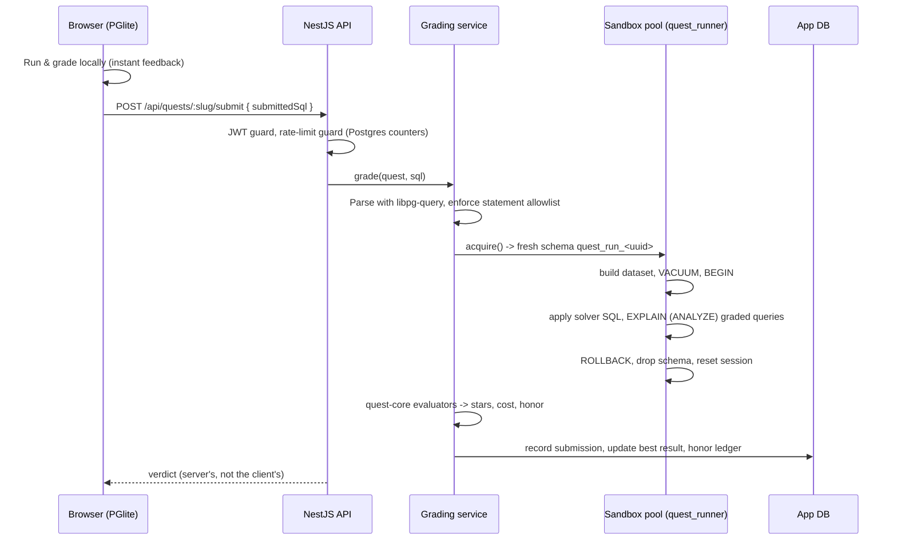
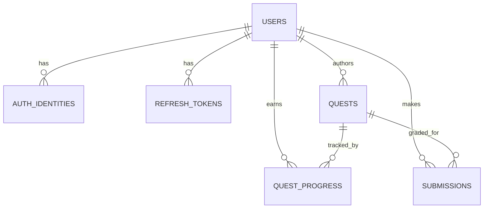

# Architecture

## Components

| Component | Tech | Responsibility |
|---|---|---|
| `apps/web` | React 19, Vite, CodeMirror 6, PGlite | Labs, quests, profile, quest editor. Runs Postgres in the browser for instant feedback |
| `apps/backoffice` | React 19, Vite | Admin-only: user list, quest moderation (approve, hide, delete) |
| `apps/server` | NestJS 10, TypeORM, PostgreSQL 16 | Auth, quest catalogue, **authoritative grading**, progress and honor, authoring, admin API |
| `packages/quest-core` | Plain TypeScript, zero runtime deps | `EXPLAIN` parser, plan summariser, constraint evaluators, grader, scoring and levels. Shared by browser and server |
| `deploy/` | Docker Compose, Caddy | Postgres, a one-shot migrate/seed job, API, and Caddy (HTTPS, static SPAs, reverse proxy) |

## Request flow: submitting a quest solution

## Server modules

| Module | Notes |
|---|---|
| `auth` | Email/password (bcrypt), Google OAuth, short-lived JWT access tokens, opaque refresh tokens stored as SHA-256 hashes and rotated on use, single-use password reset, IP-based auth rate limits |
| `quests` | Paginated catalogue, quest detail, community authoring (level-gated, publish requires a passing solution) |
| `grading` | SQL policy (AST allowlist), sandbox pool and runner, `EXPLAIN ANALYZE` capture, index footprint and write-cost measurement, rate limiting |
| `progress` | Best result per quest, honor ledger, levels, leaderboard |
| `admin` | Moderation endpoints for the back office; approving a quest recomputes honor for everyone who solved it |
| `maintenance` | Hourly purge of expired sessions, spent reset links and stale rate-limit counters |
| `health` | `GET /api/health` with a DB check, used by the platform health check |

## Data model (simplified)

Honor and level are **stored** on `users` and `quest_progress` for cheap reads. As a result, any change to scoring constants ships with a data migration that recomputes them, and approving or revoking a quest recomputes its solvers in one transaction.

## Quality gates (CI on every push and PR)

1. Lint the whole repo (oxlint)
2. `quest-core` unit tests and build (vitest)
3. Server typecheck and tests: guards, SQL policy, rate limits, config, honor rules (node:test)
4. Production builds of both frontends
5. **Migration drift check:** run migrations on a real Postgres 16, then `migration:generate --check` fails if an entity changed without a migration
6. Both production Docker images build (with GitHub Actions layer cache)

## Operations

- Single Linux server, Docker Compose. Postgres is not exposed to the internet.
- The `migrate` service runs migrations and the idempotent quest seed before every API start.
- Caddy terminates TLS automatically and serves PGlite's ~16 MB of content-hashed assets compressed and immutably cached.
- Production refuses to boot without strong secrets (≥ 32 chars), a mail provider key, and correct proxy-hop configuration.
- Sentry on API and web, configured not to collect request bodies or locals, because those carry passwords and submitted SQL.
- Daily database backups copied off the server.
