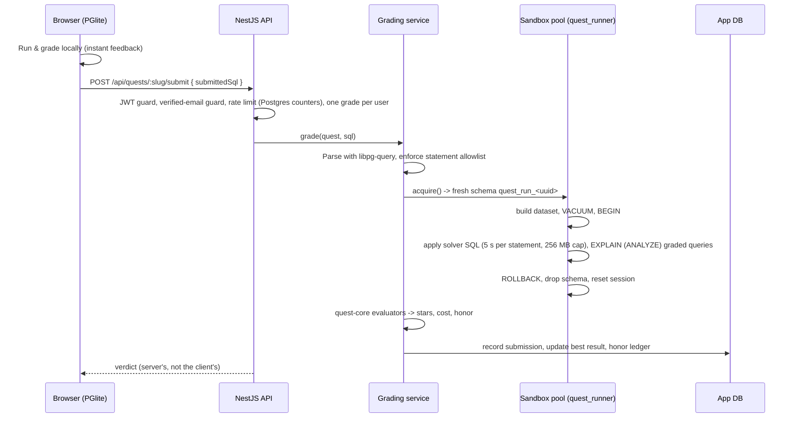
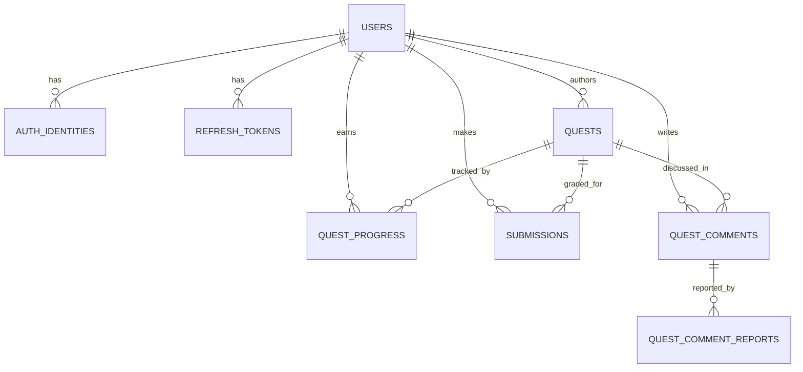

# Architecture

## Components

| Component | Tech | Responsibility |
|---|---|---|
| `apps/web` | React 19, Vite, CodeMirror 6, PGlite | Labs, quests, learning path, comments, profile, quest editor, light and dark themes. Runs Postgres in the browser for instant feedback, and keeps passed quests and SQL drafts locally for visitors without an account |
| `apps/backoffice` | React 19, Vite | Admin-only: users (sign-in methods, verification, progress, delete), quest moderation (approve, hide, delete), reported comments (remove or dismiss) |
| `apps/server` | NestJS 12, TypeORM, PostgreSQL 16 | Auth, quest catalogue, **authoritative grading**, progress and honor, authoring, comments, admin API |
| `packages/quest-core` | Plain TypeScript, zero runtime deps | `EXPLAIN` parser, plan summariser, constraint evaluators, grader, scoring and levels. Shared by browser and server |
| `deploy/` | Docker Compose, Caddy, Cloudflare Tunnel | Postgres, backup jobs, a one-shot migrate/seed job, API, Caddy (static SPAs, reverse proxy, admin gate) and `cloudflared`; optional Fluent Bit and New Relic agents |

## Request flow: submitting a quest solution

## Server modules

| Module | Notes |
|---|---|
| `auth` | Email/password (bcrypt) with email confirmation (sign-up never reveals whether an address exists), Google OAuth with PKCE and a state cookie against login CSRF, short-lived JWT access tokens, opaque refresh tokens stored as SHA-256 hashes and rotated on use, single-use password reset, IP-based auth rate limits, the admin gate Caddy calls before serving the back office |
| `quests` | Paginated catalogue, quest detail, community authoring (level-gated, publish requires a passing solution) |
| `grading` | SQL policy (AST allowlist), sandbox pool and runner, `EXPLAIN ANALYZE` capture, index footprint and write-cost measurement, result-size guard, 30 s grade deadline, one running grade per user, rate limiting, sweep of schemas left by aborted grades every 10 minutes |
| `comments` | Threaded quest comments with replies; server-side refusal of SQL and code; reports; per-user posting and reporting limits |
| `progress` | Best result per quest, honor ledger, levels, leaderboard |
| `admin` | Moderation endpoints for the back office; non-admins get the same 404 as a missing route. Approving a quest recomputes honor for everyone who solved it |
| `maintenance` | Hourly purge of expired sessions, spent reset links and stale rate-limit counters |
| `health` | `GET /api/health` with a DB check, used by the platform health check |

## Data model (simplified)

Honor and level are **stored** on `users` and `quest_progress` for cheap reads. As a result, any change to scoring constants ships with a data migration that recomputes them, and approving or revoking a quest recomputes its solvers in one transaction.

## Quality gates (CI on every push and PR)

1. Lint the whole repo (oxlint)
2. `quest-core` unit tests and build (vitest)
3. Server typecheck and tests: guards, SQL policy, rate limits, config, honor rules, email verification, comment moderation (node:test)
4. Web app unit tests (vitest), then typecheck and production builds of both frontends
5. **Migration drift check:** run migrations on a real Postgres 16, then `migration:generate --check` fails if an entity changed without a migration
6. Both production Docker images build (with GitHub Actions layer cache)

## Operations

- Single Linux server rented from Spaceship, Docker Compose, behind a Cloudflare Tunnel. No web port is open and the server's address isn't in DNS; Cloudflare terminates HTTPS. Postgres is not exposed.
- Web app, API and back office share one hostname, so the refresh cookie stays first-party.
- **Deploys:** after CI passes on `main`, a GitHub Actions job SSHes into the server (host key pinned), fast-forwards to the exact commit CI checked, and rebuilds. A database dump runs before every migration; if it fails, the migration and the new API don't start.
- The `migrate` service runs migrations and the idempotent quest seed before every API start.
- Caddy serves PGlite's ~16 MB of content-hashed assets compressed and immutably cached, and keeps each deploy's assets for 7 days so tabs opened before a deploy still load. Past that, the app reloads itself once.
- Production refuses to boot without strong secrets (≥ 32 chars), a mail provider key, and correct proxy-hop configuration.
- Sentry on API and web with release tags and uploaded source maps, configured to exclude request bodies, cookies, headers, query strings, local variables and URL fragments, because those carry passwords and submitted SQL.
- Optional New Relic: Fluent Bit ships every container's logs (the API logs JSON), and the infrastructure agent reports host and container load. The app itself has no New Relic dependency.
- Daily database dumps kept 14 days, to be copied off the server.
- **Health and uptime:** `GET /api/health` returns 200 only when the API reaches its database (503 otherwise). Docker probes it every 30 s, Postgres is probed with `pg_isready`, and services start in dependency order only once their dependencies are healthy. UptimeRobot checks the public health endpoint from outside, which covers the case where the server is down and can't report anything itself.
